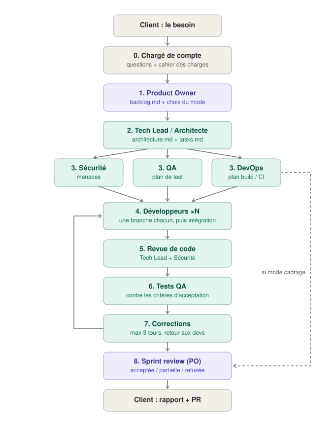

# societe-logiciel

Skill Claude Code qui simule une **société d'édition de logiciel multi-agents** : tu donnes un besoin, une équipe de sous-agents le mène en sprint Scrum autonome.

## L'équipe

- **Product Owner** — user stories, critères d'acceptation, priorités, choix du mode (cadrage ou implémentation), sprint review
- **Tech Lead / Architecte** — architecture, découpage en tâches parallélisables, revue de code
- **Développeurs** — un agent par tâche, en parallèle, chacun dans son git worktree et sur sa branche
- **DevOps** — build, CI, scripts, intégration des branches, préparation du déploiement (jamais exécuté)
- **Sécurité** — analyse de menaces puis revue sécurité du code
- **Testeurs QA** — plan de test, exécution contre les critères d'acceptation, rapport de bugs

## Déroulé



Brief → Backlog (PO) → Architecture + tâches (Tech Lead) → Cadrage sécurité / QA / DevOps
→ *(mode implémentation)* Dev en parallèle → Intégration (DevOps) → Revue Tech Lead + Sécurité → QA → boucle de correction (max 3 tours)
→ Sprint review (PO) → Rapport de sprint → Push de la branche du sprint + PR.

Tous les livrables sont écrits dans `.societe/sprint-<N>/` à la racine du projet (exclu de git via `.git/info/exclude`).

## Git

Inspiré des orchestrateurs qui isolent chaque agent dans son worktree (comme Scion) :

- une branche d'intégration `societe/sprint-<N>`, dans un worktree à côté du projet (`<projet>.societe/s<N>`) ;
- une branche et un worktree par tâche (`societe/sprint-<N>-T<k>`), où le dev commite ;
- le DevOps fusionne les branches de tâches dans la branche du sprint, résout les conflits mécaniques et renvoie les conflits de logique ;
- en fin de sprint, la branche du sprint est poussée et une PR est ouverte avec le rapport de sprint comme description.

Ton dossier de travail n'est jamais touché, et tes modifications non commitées restent hors du sprint. Dis « en local » ou « sans push » pour que rien ne soit poussé. Le détail est dans [`references/git.md`](references/git.md).

## Installation

Copie le dossier dans tes skills Claude Code :

```bash
git clone https://github.com/dragoonstor/societe-logiciel.git ~/.claude/skills/societe-logiciel
```

Puis dans Claude Code : « Lance un sprint avec la société pour … » ou `/societe-logiciel`.

## Garde-fous

L'équipe travaille sans te solliciter. Elle commite uniquement sur ses branches `societe/…` et pousse uniquement la branche du sprint. Elle ne pousse jamais sur `main` ou ta branche de base, ne fait jamais de `--force` et **ne fusionne jamais la PR** : c'est toi qui valides. Pas de déploiement ni de publication non plus.
